# Tour: on-page editing for Payload CMS

A walk through what editors see when payload-onpage is installed on a Payload CMS + Next.js site. Every image here is captured from [`examples/basic`](../examples/basic) by `bun run docs:media`, so it shows the current release.

## Edit text right on the page

Click any heading or paragraph and type. The change autosaves as a Payload draft through Payload's REST API, so access control, hooks, validation and versions all apply. Nothing on this page was annotated by hand: the text maps itself to its Payload fields.

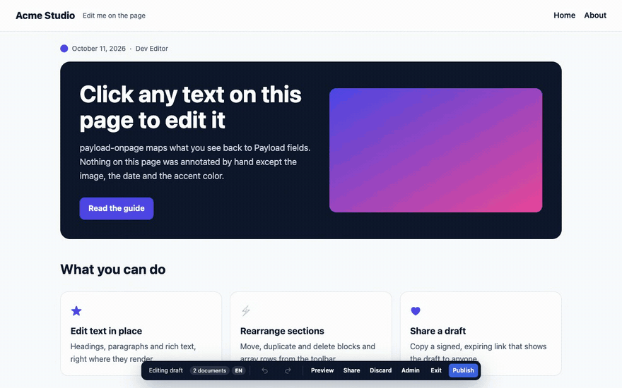

Hovering shows which field you're about to edit. The dock at the bottom shows the save status, undo and redo, preview, share and publish.


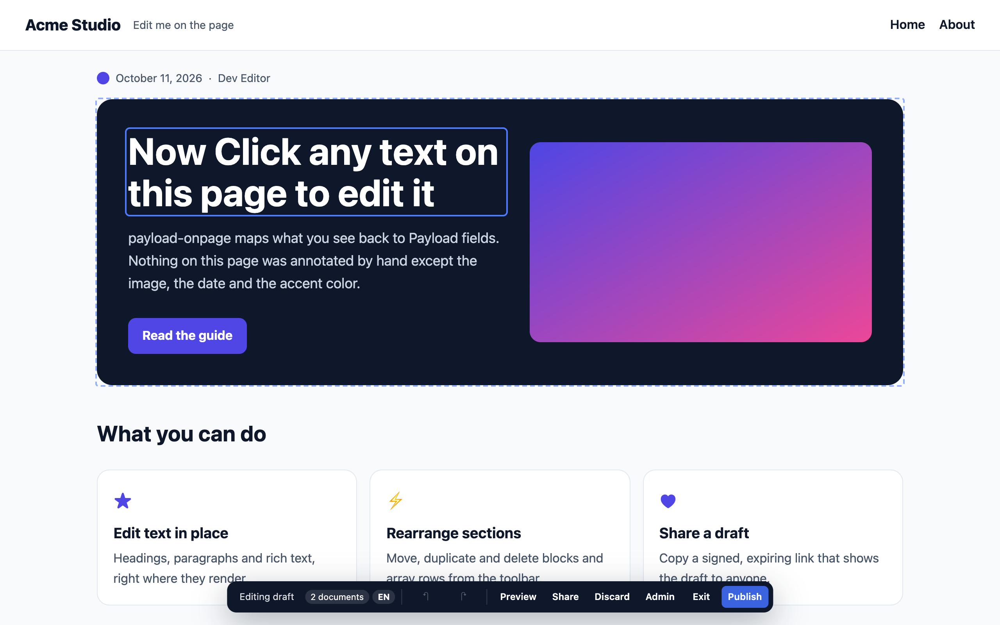

## Rearrange, add and configure sections

Sections (Payload `blocks` fields) and list items (`array` fields) get a toolbar to move, duplicate or delete them. **+ Add section** opens the blocks you've defined. Minimum and maximum rows from your config are respected.

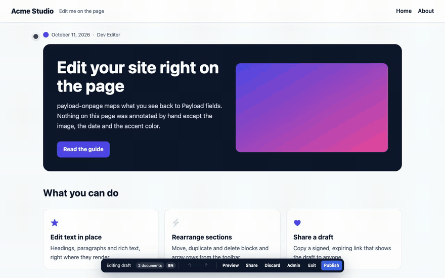


Settings that aren't text on the page, like a section's tone, a link URL or a toggle, are in the section's settings panel, generated from the block's fields:

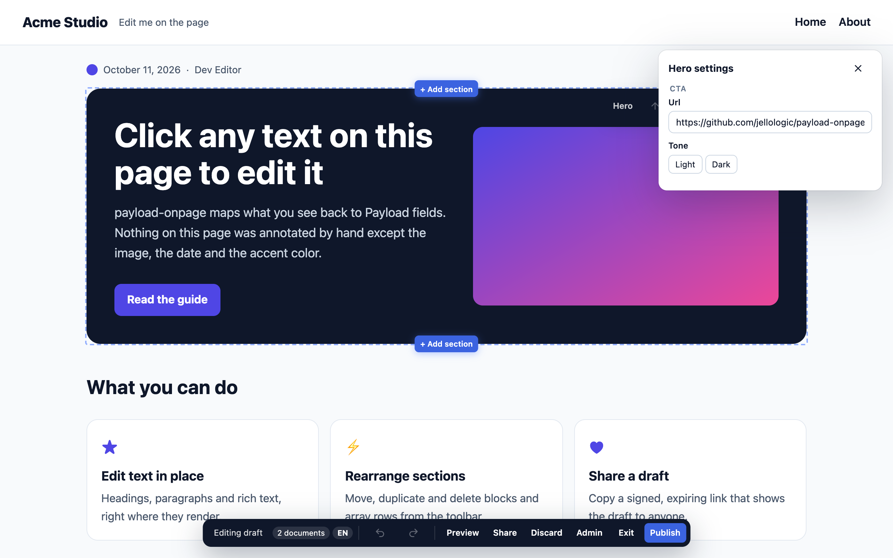

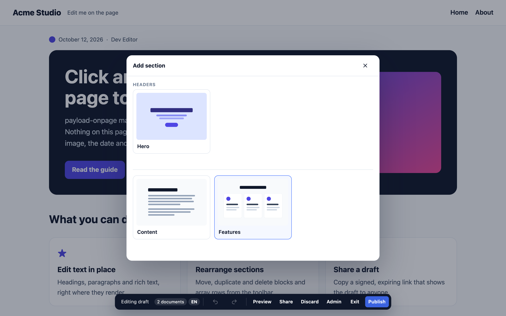

On a page in [client mode](guides/client-mode.md), pointing at a block previews it in place before it's added:

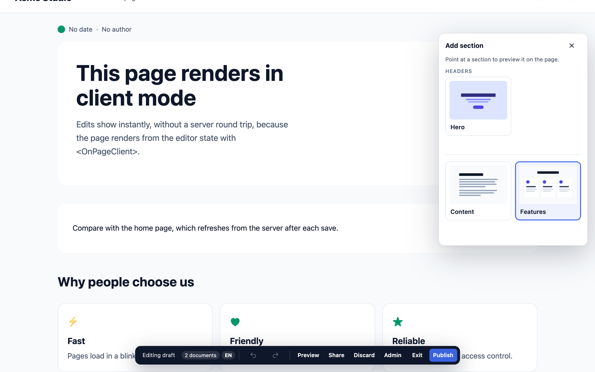

## Field editors for every kind of field

Selects, dates, numbers, relationships, colors, images and rich text each get an editor that fits. Add your own with `defineEditor` ([guide](guides/custom-field-editor.md)).

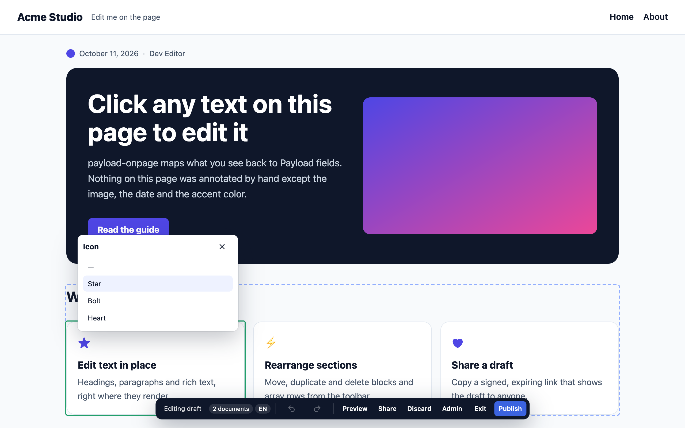

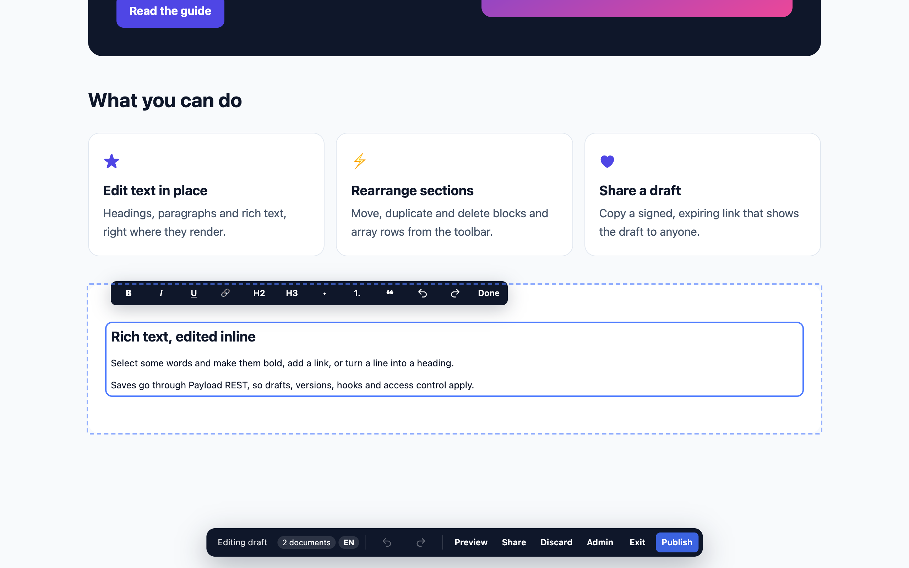

## Page settings and publishing

**Page settings** in the dock lists the page's own fields that aren't on the page: SEO title and description, dates, authors, toggles.

**Publish** publishes every document on the page with unpublished changes. The **▾** beside it lets you choose which documents to publish, or **schedule** them for later where the collection allows it ([publishing](guides/publishing.md)).

## Preview the draft, on any device

Switch to preview to see the page as visitors will, at phone, tablet or desktop width, then return to editing.

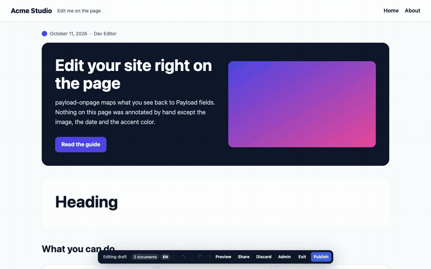

## Share a draft with a link

**Share** copies a signed, expiring link to the draft. Whoever opens it sees the draft of that one page, read-only. The link never gives them Next.js's draft-mode secret.

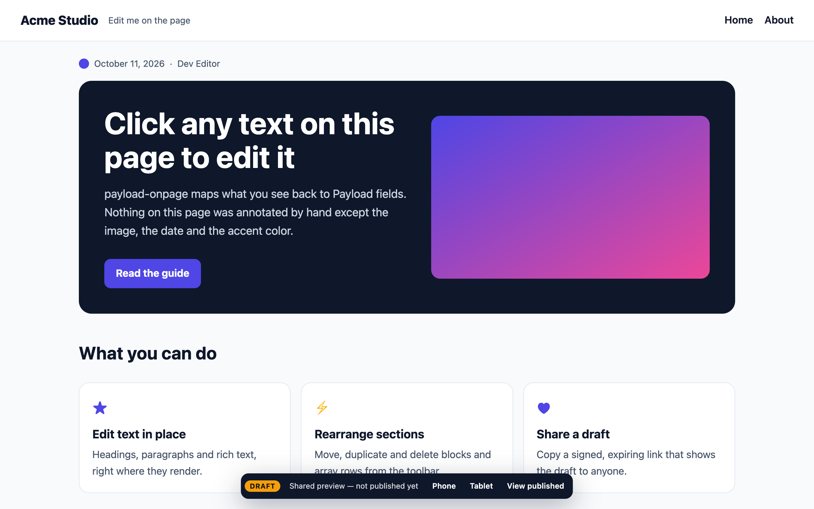

## Start from the Payload admin

Every enabled collection and global gets **Edit on page** and **Copy preview link** next to Payload's own document controls.

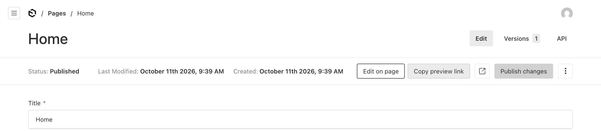

## The same tour on TanStack Start

Everything above works identically on TanStack Start (Payload 4): the editor UI, the dock, preview and share links are the same components behind a different framework adapter. Try it:

```bash
bun install && bun run dev:example-tanstack     # http://localhost:3102 — SQLite, seeds itself, signs you in
```

The demo is [`examples/tanstack`](../examples/tanstack); setup is in [Getting started with TanStack Start](getting-started-tanstack.md).

---

Ready to add it to your site? See **[Getting started](getting-started.md)** (Next.js) or **[Getting started with TanStack Start](getting-started-tanstack.md)**.

---

_Found a bug? [Report it](https://github.com/jellologic/payload-onpage/issues/new?template=bug_report.yml) or see [CONTRIBUTING.md](https://github.com/jellologic/payload-onpage/blob/main/CONTRIBUTING.md) to fix it yourself._
